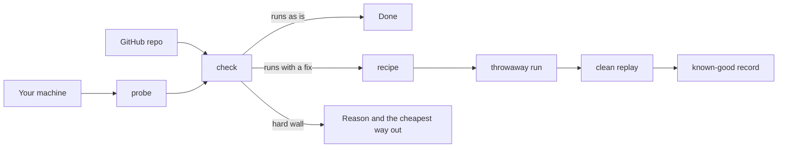
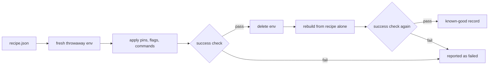
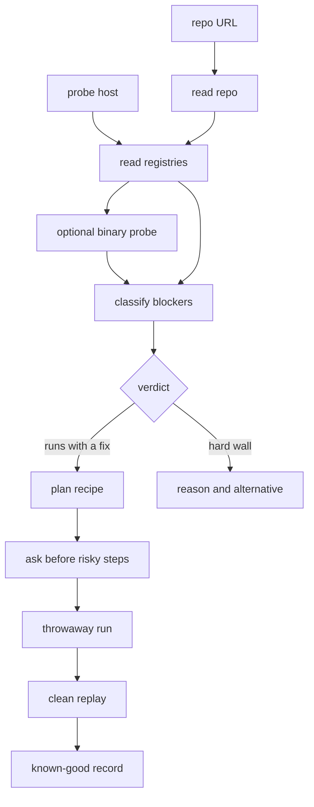

# Make Anything Compatible

**Know if a repo will run on your Mac before you lose an afternoon finding out.**

Point it at a GitHub repo. It reads your machine, reads the repo, and tells you one of three things: it runs as is, it runs with these exact changes, or it will not run here and here is why. When there is a fix, it proves the fix by building it twice, the second time from nothing.

> [!NOTE]
> This is spec stage. Nothing is implemented yet. The first work is the host probe in [issue #1](https://github.com/Troy-LL/make-anything-compatible/issues/1) and the baseline in [issue #2](https://github.com/Troy-LL/make-anything-compatible/issues/2). See [Where it's at](#where-its-at).


[](LICENSE)


[](https://github.com/Troy-LL/make-anything-compatible/actions/workflows/docs.yml)



We call it a compatibility doctor. It looks at the patient first, then the prescription, and it is allowed to say "this one is not treatable here."

## Why this exists

The tools people use to install software on Intel Macs are leaving, one at a time. Each one is a sourced fact, not a prediction:

| Layer | What changed | Source |
| --- | --- | --- |
| Homebrew | Intel macOS is Tier 3 since Sept 2026. Bottles will rarely be built, and Homebrew stops running on Intel in or after Sept 2027. | [Support Tiers](https://docs.brew.sh/Support-Tiers) |
| nixpkgs | 26.05 is the last release that supports x86_64-darwin. | [NixOS 26.05 announcement](https://nixos.org/blog/announcements/2026/nixos-2605/) |
| PyTorch | Official macOS x86_64 wheels stopped after 2.2. | [Deprecation notice](https://dev-discuss.pytorch.org/t/pytorch-macos-x86-builds-deprecation-starting-january-2024/1690) |
| Docker Desktop | 4.48.0 ended macOS 13 support, so Ventura stays on 4.48.0. | [Release notes](https://docs.docker.com/desktop/release-notes/) |
| Xcode | 15.2 is the last release for Ventura. Xcode 16 needs Sonoma 14.5 or later. | [Xcode system requirements](https://developer.apple.com/xcode/system-requirements/) |

So a lot of repos that "just work" on a new Mac fail on an older one. Some of them have a cheap fix, like an older pin or a CPU-only build. Some of them never will. Today you find out which by trying installs until one sticks or you give up.

## What you give it, what you get

| You give it | It does | You get |
| --- | --- | --- |
| Nothing but your machine | Reads the OS, CPU flags, GPU, RAM, Xcode, SDK, and runtimes. Read only. | A fingerprint, with the command behind every field |
| A repo URL | Reads its manifests, CI, README, and the registry data for what it pulls in | One verdict, and every blocker with its class and evidence |
| A "runs with a fix" verdict | Writes the exact pins, flags, and commands, runs them in a throwaway env, then rebuilds from clean | A recipe that passed replay, or a plain report that it did not |
| A call from your agent | The skills pack teaches the agent to drive the `compat` CLI | The same records a terminal run writes. JSON in and out |

## Three answers, never a fourth

| Verdict | Means | Example on the first host |
| --- | --- | --- |
| Runs as is | Nothing to change | A repo whose current wheels still ship for macOS 13 x86_64 |
| Runs with a fix | A named change gets the repo to its README demo or tests, and that change passed a clean replay | [llama.cpp](https://github.com/ggml-org/llama.cpp) with GPU offload off, after [Metal failures on this exact GPU](https://github.com/ggml-org/llama.cpp/issues/4004) |
| Hard wall | Nothing honest gets this repo running here | [MLX](https://ml-explore.github.io/mlx/build/html/install.html) needs Apple silicon and macOS 14 or later |

There is no "probably fine." A fix that has not passed replay is not a fix. If a different tool would do the job, that is a hard wall for this repo with a suggestion attached, not a success. See [decision 003](docs/decisions/003-three-verdicts-honest-walls.md).

## Six ways out

Every blocker gets exactly one class. They are tried from cheapest to most invasive:

| Class | What it means | Example |
| --- | --- | --- |
| Pin | An older release still ships for this host | `torch==2.2.2`, the last official Intel macOS wheel line |
| Rebuild | Build from source, or turn a backend off | whisper.cpp with Metal disabled |
| Swap backend | Keep the project, change what runs underneath | A Metal-only path moved to a CPU path the project already supports |
| Containerize | Run the Linux build in a disposable container | A CPU-only Linux image under Docker Desktop 4.48.0 |
| OS upgrade | Only a newer macOS lifts the limit | Reported with its risk. Never run for you |
| Hard wall | No honest path | [bitsandbytes](https://github.com/bitsandbytes-foundation/bitsandbytes), macOS 14 and arm64 only |

The rule behind the order is [decision 002](docs/decisions/002-adapt-the-software-not-the-host.md): change the software to fit the machine, not the other way round.

## See a run

This is the planned flow, not a captured result. It invents no timings or scores.

Fingerprint the machine:

```text
compat probe
  out:  records/host.json
        macOS 13.7.8, x86_64, AVX2 yes, AVX-512 no, Iris Plus 640, 8 GB, Xcode 15.2
```

Check a repo that has a fix:

```text
compat check https://github.com/ggml-org/llama.cpp
  out:  records/<runId>/verdict.json
        verdict: runs with a fix
        blocker: Metal backend on Intel GPU   class: rebuild   evidence: issue #4004
```

Plan, run, and replay it:

```text
compat plan     records/<runId>/verdict.json    ->  recipe.json
compat run      recipe.json                     ->  throwaway env, success check
compat replay   recipe.json                     ->  delete env, rebuild from recipe, check again
```

Check one that will not run:

```text
compat check https://github.com/ml-explore/mlx
  out:  verdict: hard wall
        reason:  Apple silicon and macOS 14 or later required
        instead: a CPU stack that supports x86 macOS, named in the record
```

File layout is in [architecture](docs/architecture.md#project-files).

## How it proves a fix

A recipe only counts after this:



The success check is the repo's own tests, or the demo command in its README. Research on setup agents points the same way: a clean rebuild is what separates a result you can trust from one that only worked in a dirty shell. See [decision 004](docs/decisions/004-clean-replay-is-the-proof.md).

## Use it from your agent

Planned. Install the skills pack, then ask your agent. The skills teach it to drive the `compat` CLI and to report a hard wall plainly.

```sh
npx skills add https://github.com/Troy-LL/make-anything-compatible
```

You can also copy the skill folders into `~/.cursor/skills`, `~/.claude/skills`, or `~/.codex/skills`.

Ask your agent:

```text
I want to run this repo on my 2017 MacBook Pro. Check it first. If there's a fix, show me the recipe before you install anything, then prove it with a clean replay. If it can't run here, tell me why and what I could use instead.
```

Or from the terminal:

```text
# Planned
compat probe
compat check <repo>
compat plan
compat run
compat replay
```

A tiny MCP server may come later as an extra. It is not part of the first version. See [decision 006](docs/decisions/006-skills-first-interface.md).

## How it's different from setup agents

There is a lot of good work on agents that set up a repo for you. Almost all of it assumes a Linux container.

- They pick a Docker base image. We read the machine you actually have, and that machine is the constraint.
- They treat "this hardware cannot do it" as a failure. For us it is a verdict. One setup agent paper found hardware insufficiency was the top failure class on its benchmark (paper, self-reported).
- They report success when an install finishes. We only report success after a clean replay reaches the repo's own check.
- They do not try macOS. One multi-platform setup paper skipped macOS because no public macOS CLI images exist (paper, self-reported).

Sources are in [Prior art](#prior-art) below.

## What counts as done

The first version is done only when all four hold. The full text is [decision 005](docs/decisions/005-mvp-win-condition.md).

- [ ] On the frozen 30-repo set, on the first host, with the same agent and model, an agent using MAC reaches more success checks after clean replay than the same agent without it. Scripts and results are committed so anyone with the host can rerun them.
- [ ] Zero false "fixed" claims. Every repo reported as running passed replay, and MAC declares at least as many of the expected hard walls correctly as the baseline.
- [ ] The same run works from the CLI and from an agent via the skills pack, and writes the same records.
- [ ] Every run stays inside throwaway environments and under the spend cap and per-repo time limit set in [issue #2](https://github.com/Troy-LL/make-anything-compatible/issues/2). No OS changes and no binary patches.

<details>
<summary>Under the hood</summary>

An editor-neutral library owns the pipeline. The `compat` CLI is the engine. The skills pack teaches agents to drive the CLI. See [architecture](docs/architecture.md).



| Record | What's in it |
| --- | --- |
| `records/host.json` | The fingerprint. Each field has a value, a source command, and `unknown` with a reason when it cannot be read |
| `records/<runId>/verdict.json` | The verdict and each blocker with its class and evidence |
| `records/<runId>/recipe.json` | Ordered pins, flags, commands, and the success check |
| `records/<runId>/replay.json` | Both runs, the check output, and pass or fail |
| `known-good/` | One row per repo, commit or release, and host fingerprint |

</details>

<details>
<summary>The first host</summary>

The first target is one real machine. Field names stay general so other constrained hosts can follow. See [decision 001](docs/decisions/001-constrained-hardware-first-host.md).

| Part | Value | Why it matters | Source |
| --- | --- | --- | --- |
| Model | MacBook Pro 14,1 (2017) | The last supported macOS for it is Ventura | prior notes |
| CPU | Intel Core i5-7360U | AVX2 yes, AVX-512 no | [Intel ARK](https://www.intel.com/content/www/us/en/products/sku/97535/intel-core-i57360u-processor-4m-cache-up-to-3-60-ghz/specifications.html) |
| GPU | Intel Iris Plus 640 | Metal 3 capable, no Metal 4. Metal compute is unreliable for some ML code | [Apple Metal support](https://support.apple.com/en-us/102894) |
| RAM | 8 GB | "It installed" and "it is usable" are different answers | prior notes |
| OS | macOS 13.7.8 Ventura | Many current releases need macOS 14 or later | [Ollama v0.12.5](https://github.com/ollama/ollama/releases/tag/v0.12.5) for one example |
| Xcode | 15.2 cap, macOS 14.2 SDK, Swift 5.9 | No Swift 6 and no newer SDK from Apple on this OS | [Xcode system requirements](https://developer.apple.com/xcode/system-requirements/) |
| Rosetta | No help | It translates Intel apps on Apple silicon, not the other way | [Apple](https://support.apple.com/en-us/102527) |

</details>

<details>
<summary>Commands</summary>

These commands are specified, not implemented.

| CLI command | What it does | Issue |
| --- | --- | --- |
| `compat probe` | Fingerprint the host. Read only | [#1](https://github.com/Troy-LL/make-anything-compatible/issues/1) |
| `compat check <repo>` | Read the repo and registries, classify blockers, write a verdict | [#3](https://github.com/Troy-LL/make-anything-compatible/issues/3) |
| `compat plan` | Turn a verdict into a recipe | [#4](https://github.com/Troy-LL/make-anything-compatible/issues/4) |
| `compat run` | Run the recipe in a throwaway env, asking before risky steps | [#4](https://github.com/Troy-LL/make-anything-compatible/issues/4) |
| `compat replay` | Rebuild from clean and check again | [#4](https://github.com/Troy-LL/make-anything-compatible/issues/4) |

`compat` is a working name.

</details>

<details>
<summary>Prior art</summary>

Numbers are what each source reports. Tags say who is speaking. Metrics differ between papers, so rows are not comparable to each other.

| Work | What it does | What it reports | Tag |
| --- | --- | --- | --- |
| [Repo2Run](https://arxiv.org/abs/2502.13681) | Builds a Dockerfile for Python repos | 86.0% build success on 420 repos | paper, self-reported |
| [RAT, RunAnyThing](https://arxiv.org/abs/2604.23190) | Multi-language setup agent in containers | Hardware-dependent environments are out of scope | paper |
| [EvoConfig](https://arxiv.org/abs/2601.16489) | Environment configuration agent | Hardware insufficiency is 32.4% of its failures on EnvBench | paper, self-reported |
| [RepoLaunch](https://arxiv.org/abs/2603.05026) | Windows and Linux setup | macOS not tested, no public macOS CLI images | paper, self-reported |
| [Graph2Env](https://arxiv.org/abs/2609.33429) | Setup with clean rebuild checks | A general coding agent beat older specialized setup agents on hard Python repos | paper, self-reported |
| [MacPorts legacy-support](https://github.com/macports/macports-legacy-support) | Backfills missing APIs on old OS X | Aimed at much older releases than Ventura | vendor |
| [REA](https://github.com/morluto/rea) | Agent tool for inspecting binaries | Reads a Mach-O's minimum OS and SDK. An optional probe for us, see [decision 007](docs/decisions/007-optional-binary-probe.md) | vendor |

Unverified so far: Colima, Lima, and OrbStack on Ventura; whether conda-forge PyTorch keeps MPS on Intel; GPU family limits for Iris Plus 640; OpenCore Legacy Patcher on this exact model.

</details>

## Where it's at

Spec stage. Nothing is implemented. Issues are the source of work.

| Issue | What | Depends on |
| --- | --- | --- |
| [#1](https://github.com/Troy-LL/make-anything-compatible/issues/1) | Host probe | None. First |
| [#2](https://github.com/Troy-LL/make-anything-compatible/issues/2) | Frozen eval set of 30 repos and a plain-agent baseline | None. Measurement only |
| [#3](https://github.com/Troy-LL/make-anything-compatible/issues/3) | Blocker classifier | #1, #2 |
| [#4](https://github.com/Troy-LL/make-anything-compatible/issues/4) | Recipe, throwaway run, and clean replay | #3 |
| [#5](https://github.com/Troy-LL/make-anything-compatible/issues/5) | Skills pack and CLI | #1, #3, #4 |

Docs: [architecture](docs/architecture.md), [design](docs/design.md), [eval](docs/eval.md), decisions [001](docs/decisions/001-constrained-hardware-first-host.md), [002](docs/decisions/002-adapt-the-software-not-the-host.md), [003](docs/decisions/003-three-verdicts-honest-walls.md), [004](docs/decisions/004-clean-replay-is-the-proof.md), [005](docs/decisions/005-mvp-win-condition.md), [006](docs/decisions/006-skills-first-interface.md), [007](docs/decisions/007-optional-binary-probe.md).

## Want to help?

Useful now, before any code exists:

- A repo that fails on an older Mac today, with a link that shows why. Use the "Eval repo" issue form. The Node, Go, and Rust slice of [issue #2](https://github.com/Troy-LL/make-anything-compatible/issues/2) needs the most help.
- A host report from a different constrained machine, using the "Host report" form.
- A correction. If a fact in these docs is out of date, open a bug with the source.

See [CONTRIBUTING.md](CONTRIBUTING.md). Run `bash scripts/verify-docs.sh` before you ask for review.

## License

Apache License 2.0. Copyright 2026 Troy-LL. See [LICENSE](LICENSE).
