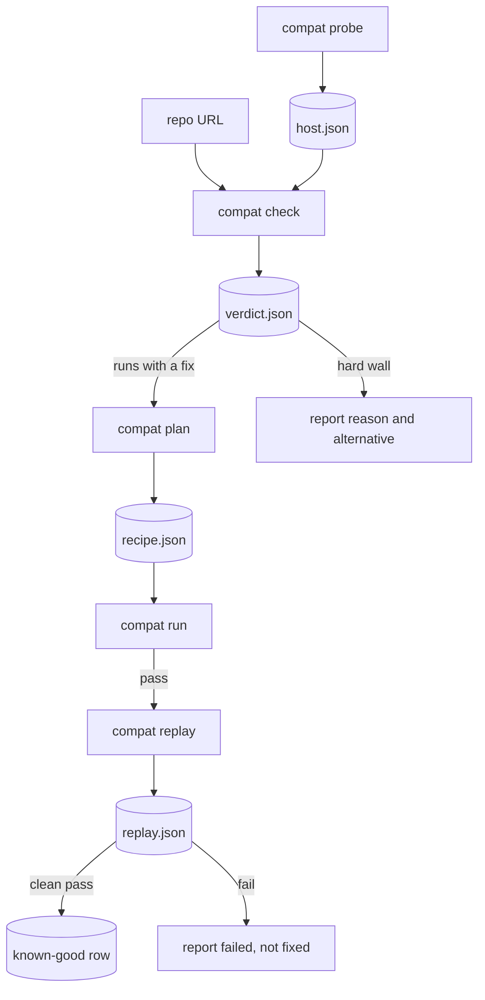

# Architecture

Make Anything Compatible reads a host and a repo, decides whether the repo can run there, and proves any fix by clean replay. There is no runnable code yet. This file is the shape the implementation must follow.

## Processes

- **Library.** Editor-neutral core. It owns probe, check, plan, run, replay, and the known-good record. No IDE-specific code lives here.
- **CLI.** The `compat` binary calls the library. JSON in, JSON out. The skills pack and any later wrapper call this, not the library directly.
- **Skills pack.** SKILL.md folders in this repo, following the Agent Skills standard. They teach an agent the order probe, check, plan, ask, run, replay, report. Install is planned as `npx skills add https://github.com/Troy-LL/make-anything-compatible`, or by copying the folders into `~/.cursor/skills`, `~/.claude/skills`, or `~/.codex/skills`. See [decision 006](decisions/006-skills-first-interface.md).
- **Host probe.** Read-only commands (`sw_vers`, `sysctl`, `system_profiler`, `xcodebuild -version`, `xcrun --show-sdk-version`, and runtime `--version` calls). No network, no `sudo`.
- **Repo reader.** Static reads of README, CI files, and manifests: `pyproject.toml`, `requirements*.txt`, lockfiles, `environment.yml`, `Package.swift`, `*.xcodeproj` settings, `package.json`, `go.mod`, `Cargo.toml`.
- **Registry reader.** Live lookups of wheel tags and minimum macOS on PyPI, and the matching data on npm, crates, and GitHub release assets. Nothing is answered from memory.
- **Binary probe (optional).** Reads arch slices and minimum OS from shipped Mach-O files. Uses `otool` and `lipo` by default, and REA `inspect_macho` when it is installed. See [decision 007](decisions/007-optional-binary-probe.md).
- **Classifier.** Turns the facts into blockers, gives each one class, and picks the verdict.
- **Planner.** Turns a "runs with a fix" verdict into an ordered recipe, following the ladder in [decision 002](decisions/002-adapt-the-software-not-the-host.md).
- **Sandbox runner.** Applies a recipe inside a throwaway env and runs the success check.
- **Replayer.** Deletes the env, rebuilds from the recipe alone, and runs the check again. See [decision 004](decisions/004-clean-replay-is-the-proof.md).
- **Eval runner.** Runs the frozen set and writes dated results under `evals/`. See [eval](eval.md).

## Records

Every command reads and writes these. A later step reads one of them; it does not invent a parallel shape. Each has a `schemaVersion`.

### Host fingerprint

`records/host.json`. One entry per field: `value`, `source` (the command or file it came from), and `volatile` (true for things like free disk). A field that cannot be read has `value: "unknown"` and a `reason`. Fields: `os` (`name`, `version`, `build`), `arch`, `model`, `cpu` (`name`, `features[]`), `ramBytes`, `gpu` (`name`, `metal`), `xcode` (`version`, `sdk`, `swift`), `clt`, `runtimes` (`python`, `conda`, `node`, `go`, `rust`), `docker` (`version`). The fingerprint hash is computed over non-volatile fields.

### Verdict

`records/<runId>/verdict.json`. `repo` (`url`, `ref`), `hostHash`, `verdict` (`runs-as-is`, `runs-with-fix`, `hard-wall`), and `blockers[]`. A blocker has `id`, `what`, `class` (`pin`, `rebuild`, `swap-backend`, `containerize`, `os-upgrade`, `hard-wall`), `evidence[]` (`kind`: file, registry, or url; plus a pointer), and `alternative` when the class is `hard-wall` or `os-upgrade`.

### Recipe

`records/<runId>/recipe.json`. `env` (`kind`: venv, conda, or container; plus the base), ordered `steps[]` (each a command, why it is there, and whether it needs a yes from the user), and `successCheck` (a command and what passing looks like).

### Replay result

`records/<runId>/replay.json`. Two attempts, `first` and `clean`, each with start and end time, exit codes, the success check output, and `passed`. The run counts only when `clean.passed` is true.

### Known-good record

One row per repo, ref, and host hash under `known-good/`: verdict, the recipe, evidence URLs, the replay result, and the date it was last replayed. Rows go stale, so they carry that date and are re-verified, not trusted forever.

## Data flow

## Sandboxes

| Sandbox | Use | Notes |
| --- | --- | --- |
| Throwaway venv or conda env | First choice for Python pins and CPU rebuilds | Weak isolation. Never system Python |
| Disposable Linux container | Only for the containerize class | On the first host this is Docker Desktop 4.48.0. Linux x86_64 runs natively. No Metal inside |
| Linux VM (UTM) | Fallback if Docker is not available | Not checked yet |
| macOS guest VM | Not planned | Heavy, and still capped at the host's OS |

Jobs are limited in CPU and memory to fit an 8 GB host.

## Project files

| Path | What's in it |
| --- | --- |
| `records/host.json` | The fingerprint |
| `records/<runId>/` | Verdict, recipe, replay result, and logs for one repo |
| `known-good/` | Rows that passed clean replay |
| `evals/<date>/` | Frozen-set runs and score tables |
| `skills/` | The skills pack |

## What this system does not do

- Change the OS. An OS upgrade is reported, never run.
- Patch, re-sign, or redistribute proprietary binaries.
- Install into system Python or write outside the throwaway env.
- Run `sudo`, `curl | sh`, or an upstream install script without a yes from the user.
- Call a repo fixed without a passing clean replay.
